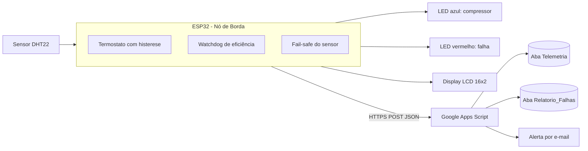

# Auditoria de Logs e Relatórios Automatizados com IoT na Climatização Corporativa

Projeto integrador que demonstra como um nó de borda IoT (ESP32) pode controlar um ar-condicionado, detectar falhas de eficiência antes que alguém perceba e transformar isso em telemetria, alerta e relatório de custo automaticamente, sem depender da abertura manual de chamados.

A simulação roda no [Wokwi](https://wokwi.com) e os dados são gravados em uma planilha Google Sheets por meio de um Google Apps Script.

## O problema

Em escritórios corporativos, um ar-condicionado com defeito mecânico ou sem gás continua consumindo carga máxima (cerca de 1200 W) sem refrigerar o ambiente. Como o equipamento "está ligado", ninguém abre chamado. O resultado é desperdício financeiro silencioso e subnotificação de avarias para as equipes de Facility Management e Service Desk.

## A solução

O ESP32 toma as decisões críticas localmente (edge computing) e envia a telemetria para a nuvem, onde ela é auditada:

1. **Controle por histerese:** setpoint de 23,0 °C. O compressor liga em ≥ 24,0 °C e desliga em ≤ 22,5 °C, evitando o *short-cycling* que desgasta relés e motores.
2. **Watchdog de eficiência térmica (manutenção preditiva):** se o compressor fica ligado por mais de 20 s sem que a temperatura caia pelo menos 0,5 °C, o nó assume anomalia mecânica ou vazamento de fluido refrigerante e reporta `FALHA_EFICIENCIA`.
3. **Fail-safe do sensor:** se o DHT22 for desconectado ou queimar, o compressor é cortado imediatamente e o nó reporta `ERRO_SENSOR_OFFLINE`. Quando o sensor volta, o sistema se recupera sozinho.
4. **Auditoria na nuvem:** cada leitura é gravada na aba `Telemetria`. A aba `Relatorio_Falhas` é atualizada automaticamente com o status atual, os eventos de falha, o tempo em falha, a energia desperdiçada, o custo em R$ e uma projeção mensal.
5. **Alerta por e-mail:** quando uma nova falha começa, um e-mail é enviado uma única vez por evento.

> O tempo de 20 s do watchdog é reduzido para fins de demonstração. Em um equipamento real, o valor seria da ordem de minutos.

## Arquitetura



O firmware é organizado em três camadas:

| Camada | Responsabilidade | Componentes |
| --- | --- | --- |
| Domínio | Regras do termostato e do diagnóstico, sem dependência de hardware | `ControladorTermostato`, `Diagnostico` |
| Adaptadores | Comunicação com o mundo físico e com a rede | `SensorAmbienteDHT`, `SaidaDigital`, `DisplayDeStatus`, `ConexaoWifi`, `ClienteTelemetriaGoogleSheets` |
| Aplicação | Orquestra o ciclo ler → decidir → atuar → exibir → reportar | `AplicacaoClimatizacao` |

## Estrutura do repositório

| Arquivo | Descrição |
| --- | --- |
| `sketch.ino` | Firmware do ESP32 |
| `diagram.json` | Circuito do Wokwi (ligações dos componentes) |
| `libraries.txt` | Bibliotecas necessárias no Wokwi |
| `script-envio-e-analise-de-metricas.js` | Código do Google Apps Script (cole no arquivo `Código.gs` do projeto) |

## Hardware e ligações

| Componente | Pino do ESP32 | Observação |
| --- | --- | --- |
| DHT22 (dados) | GPIO 4 | Alimentado em 3,3 V |
| LED azul (compressor) | GPIO 14 | Com resistor de 220 Ω; representa o relé do compressor |
| LED vermelho (falha) | GPIO 13 | Com resistor de 220 Ω |
| LCD 16x2 I2C (SDA) | GPIO 21 | Endereço `0x27` |
| LCD 16x2 I2C (SCL) | GPIO 22 | |

> Em bancada física, um backpack I2C alimentado em 5 V mantém pull-ups de 5 V em SDA/SCL, acima do que o ESP32 tolera. Use um conversor de nível ou um módulo que funcione em 3,3 V.

## Diagnósticos

| Código | Significado | Compressor | LED vermelho | LCD |
| --- | --- | --- | --- | --- |
| `STANDBY_ECO` | Temperatura dentro da meta, equipamento em espera (5 W) | Desligado | Apagado | `AR:OFF D:ECO` |
| `RESFRIANDO` | Compressor ligado há menos de 20 s (1200 W) | Ligado | Apagado | `AR:ON D:COOL` |
| `RESFRIANDO_OK` | Compressor ligado e a temperatura caiu o esperado | Ligado | Apagado | `AR:ON D:COOL` |
| `FALHA_EFICIENCIA` | Compressor ligado sem resfriar | Ligado | Aceso | `AR:ON D:FALHA` |
| `ERRO_SENSOR_OFFLINE` | Sensor sem resposta, fail-safe ativado | Desligado | Aceso | `ERR: SENSOR DHT` |

## Contrato da telemetria

O ESP32 envia a cada 7 s um `POST` com o seguinte JSON:

```json
{
  "temperatura": 24.0,
  "umidade": 40.0,
  "setpoint": 23.0,
  "status_compressor": "LIGADO",
  "potencia_w": 1200.0,
  "diagnostico": "FALHA_EFICIENCIA"
}
```

Com o sensor offline, `temperatura` e `umidade` são enviados como `null`, para não contaminar a auditoria com leituras falsas.

## Como executar

### 1. Planilha e Apps Script

1. Crie uma planilha no Google Sheets com uma aba chamada `Telemetria` e, na linha 1, os cabeçalhos: `Data/Hora`, `Temperatura (°C)`, `Umidade (%)`, `Setpoint (°C)`, `Compressor`, `Potência (W)`, `Diagnóstico`.
2. Abra **Extensões › Apps Script**, cole o conteúdo de `script-envio-e-analise-de-metricas.js` no arquivo `Código.gs` e salve.
3. Ajuste no topo do script a tarifa de energia (`TARIFA_ENERGIA_REAIS_POR_KWH`) e, se quiser, o e-mail que receberá os alertas (`EMAIL_DESTINATARIO_DOS_ALERTAS`; vazio envia para o dono da planilha).
4. Recarregue a planilha e clique em **Auditoria IoT › Configurar projeto (executar uma vez)**. Aceite as permissões, incluindo a de envio de e-mail.
5. Publique em **Implantar › Nova implantação › App da Web**, com "Executar como: Eu" e "Quem pode acessar: Qualquer pessoa". Copie a URL gerada.

> Sempre que alterar o script, publique uma **nova versão** da implantação existente (Gerenciar implantações › lápis › Nova versão). Criar uma implantação nova gera outra URL.

### 2. Simulação no Wokwi

1. Crie um projeto ESP32 no Wokwi e substitua `sketch.ino`, `diagram.json` e `libraries.txt` pelos arquivos deste repositório.
2. Em `sketch.ino`, coloque a URL da sua implantação na constante `URL_GOOGLE_APPS_SCRIPT`.
3. Inicie a simulação. O monitor serial mostra a conexão Wi-Fi, cada leitura e o resultado de cada envio.

## Roteiro de demonstração

| Cenário | Ação no Wokwi | Resultado esperado |
| --- | --- | --- |
| 1. Operação normal | Subir o DHT22 para 25 °C | LED azul liga, `RESFRIANDO`, 1200 W. Baixando para 24,4 °C antes de 20 s, passa para `RESFRIANDO_OK` |
| 2. Meta atingida | Baixar para 21 °C | LED azul desliga, `STANDBY_ECO`, 5 W |
| 3. Falha térmica preditiva | Subir para 30–34 °C e aguardar 20 s | LED vermelho acende, `FALHA_EFICIENCIA`, relatório fica vermelho e o e-mail de alerta é enviado |
| 4. Fail-safe do sensor | Apagar o fio de dados (GPIO 4) | Compressor desliga na hora, `ERRO_SENSOR_OFFLINE`. Ao religar o fio, o sistema se recupera sozinho |

Ao final, a aba `Relatorio_Falhas` mostra quanto tempo o equipamento passou em falha, a energia desperdiçada, o custo e a projeção mensal (8 h/dia, 22 dias úteis) caso a falha não fosse detectada.

## Problemas conhecidos e soluções adotadas

| Problema | Causa | Solução |
| --- | --- | --- |
| Leituras `NaN` constantes do DHT22 | A biblioteca `DHTesp` conflitava com a temporização do Wi-Fi no Wokwi | Troca pela `DHT sensor library` da Adafruit |
| Resposta `HTTP 302` | O Apps Script executa o `doPost` e depois redireciona para o resultado | O `302` é tratado como sucesso, sem seguir o redirecionamento |
| `read Timeout (-11)` no primeiro envio | "Partida a frio" do Apps Script após um período parado | Tempo limite de resposta de 15 s, sem repetir o envio (o servidor já recebeu os dados) |
| `connection refused (-1)` intermitente | Instabilidade do gateway de rede público do Wokwi com conexões HTTPS | Até 3 tentativas com intervalo, e log de memória livre para descartar falta de memória |
| Linhas só com data/hora na planilha | O script antigo lia `e.parameter` e o `doGet` gravava linhas ao abrir a URL | Leitura via `JSON.parse(e.postData.contents)` e `doGet` apenas como verificação de saúde |

## Limitações

Este é um protótipo acadêmico. A conexão HTTPS usa `setInsecure()`, sem validação de certificado, e a URL do Apps Script é pública, então qualquer pessoa com o link pode enviar dados. Em produção, o recomendado seria validar o certificado, autenticar o dispositivo com um token e usar um backend de observabilidade dedicado no lugar da planilha. A potência é estimada pelo estado do compressor, e não medida por um sensor de corrente.

## Autor

Victor Hugo ([@VHAPorfirium](https://github.com/VHAPorfirium))
