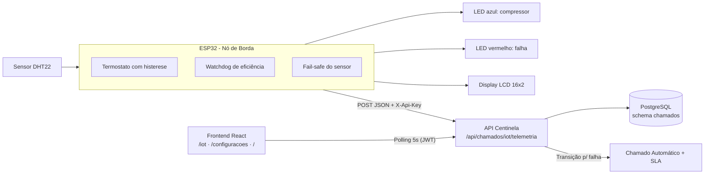

# Auditoria de Logs e Relatórios Automatizados com IoT na Climatização Corporativa

Projeto integrador que demonstra como um nó de borda IoT (ESP32) controla um ar-condicionado, detecta falhas de eficiência antes que alguém perceba e envia a telemetria diretamente para a **API de Chamados e Relatórios (Plataforma Centinela Soluções)**, fechando o ciclo completo: **sensor → auditoria de custo em tempo real no frontend → abertura automática de chamado com SLA → atendimento e fechamento na Fila**.

A simulação roda no [Wokwi](https://wokwi.com) e se comunica diretamente com o endpoint `POST /api/chamados/iot/telemetria` autenticado por `X-Api-Key`.

## O problema

Em escritórios corporativos, um ar-condicionado com defeito mecânico ou sem gás continua consumindo carga máxima (cerca de 1200 W) sem refrigerar o ambiente. Como o equipamento "está ligado", ninguém abre chamado. O resultado é desperdício financeiro silencioso e subnotificação de avarias para as equipes de Facility Management e Service Desk.

## A solução (Ciclo Completo)

O ESP32 toma as decisões críticas localmente (*edge computing*) e envia a telemetria diretamente para a API Centinela:

1. **Controle por histerese:** setpoint de 23,0 °C. O compressor liga em ≥ 24,0 °C e desliga em ≤ 22,5 °C, evitando *short-cycling*.
2. **Watchdog de eficiência térmica (manutenção preditiva):** se o compressor fica ligado por mais de 20 s sem que a temperatura caia pelo menos 0,5 °C, o nó reporta `falha_eficiencia`.
3. **Fail-safe do sensor:** se o DHT22 for desconectado ou falhar, o compressor é cortado imediatamente e o nó reporta `erro_sensor_offline` (com `temperatura` e `umidade` como `null`).
4. **Telemetria, auditoria e abertura automática de chamado na API:** cada leitura é persistida no PostgreSQL isolada por tenant (`chamados.iot_leituras`). Na transição para falha, a API abre automaticamente um **Chamado** com SLA calculado (sem duplicar enquanto houver chamado em aberto).
5. **Painel em tempo real no Frontend:** a tela **Monitoramento IoT** (`/modulos/chamados/iot`) exibe status ao vivo (atualização a cada 5 s), gráfico de temperatura × setpoint, auditoria de energia desperdiçada (kWh), custo (R\$), projeção mensal e link direto para atender e encerrar o chamado aberto na Fila.

> O tempo de 20 s do watchdog é reduzido para fins de demonstração. Em um equipamento real, o valor seria da ordem de minutos.

## Arquitetura



O firmware é organizado em três camadas:

| Camada | Responsabilidade | Componentes |
| --- | --- | --- |
| Domínio | Regras do termostato e do diagnóstico, sem dependência de hardware | `ControladorTermostato`, `Diagnostico` |
| Adaptadores | Comunicação com o mundo físico e com a API HTTP/HTTPS | `SensorAmbienteDHT`, `SaidaDigital`, `DisplayDeStatus`, `ConexaoWifi`, `ClienteTelemetriaApi` |
| Aplicação | Orquestra o ciclo ler → decidir → atuar → exibir → reportar | `AplicacaoClimatizacao` |

## Estrutura do repositório

| Arquivo | Descrição |
| --- | --- |
| `sketch.ino` | Firmware do ESP32 integrado à API Centinela (`X-Api-Key`) |
| `diagram.json` | Circuito do Wokwi (ligações dos componentes) |
| `libraries.txt` | Bibliotecas necessárias no Wokwi |
| `legado/` | Scripts e planilha da versão anterior com Google Sheets (arquivados para histórico) |

## Hardware e ligações

| Componente | Pino do ESP32 | Observação |
| --- | --- | --- |
| DHT22 (dados) | GPIO 4 | Alimentado em 3,3 V |
| LED azul (compressor) | GPIO 14 | Com resistor de 220 Ω; representa o relé do compressor |
| LED vermelho (falha) | GPIO 13 | Com resistor de 220 Ω |
| LCD 16x2 I2C (SDA) | GPIO 21 | Endereço `0x27` |
| LCD 16x2 I2C (SCL) | GPIO 22 | |

## Diagnósticos

| Código | Significado | Compressor | LED vermelho | LCD |
| --- | --- | --- | --- | --- |
| `standby_eco` | Temperatura dentro da meta, equipamento em espera (5 W) | Desligado | Apagado | `AR:OFF D:ECO` |
| `resfriando` | Compressor ligado há menos de 20 s (1200 W) | Ligado | Apagado | `AR:ON D:COOL` |
| `resfriando_ok` | Compressor ligado e a temperatura caiu o esperado | Ligado | Apagado | `AR:ON D:COOL` |
| `falha_eficiencia` | Compressor ligado sem resfriar (abre chamado automático) | Ligado | Aceso | `AR:ON D:FALHA` |
| `erro_sensor_offline` | Sensor sem resposta, fail-safe ativado | Desligado | Aceso | `ERR: SENSOR DHT` |

## Contrato da telemetria

O ESP32 envia a cada 7 s (e imediatamente a cada mudança de diagnóstico) um `POST /api/chamados/iot/telemetria` com o cabeçalho `X-Api-Key: <chave-do-dispositivo>` e corpo JSON:

```json
{
  "temperatura": 32.0,
  "umidade": 40.0,
  "setpoint": 23.0,
  "status_compressor": "ligado",
  "potencia_w": 1200.0,
  "diagnostico": "falha_eficiencia"
}
```

Com o sensor offline, `temperatura` e `umidade` são enviados como `null`.

## Como executar o ciclo completo

### 1. Cadastrar o dispositivo na plataforma

1. Acesse o frontend em `/modulos/chamados/configuracoes?aba=iot` (aba **Dispositivos IoT**).
2. Clique em **Novo dispositivo IoT**, informe nome, localização, tarifa de energia (R\$/kWh) e mantenha marcada a opção **Abrir chamado automaticamente**.
3. Ao salvar, a plataforma exibirá a chave `X-Api-Key` e o bloco pronto com as constantes do `sketch.ino`.

### 2. Configurar e rodar o ESP32 no Wokwi

1. Abra o projeto no Wokwi com `sketch.ino`, `diagram.json` e `libraries.txt`.
2. Cole as constantes geradas pela tela em `namespace Configuracao` no topo de `sketch.ino`:
   - `NOME_SERVIDOR_TELEMETRIA`
   - `PORTA_SERVIDOR_TELEMETRIA` (`443` para HTTPS ou `80`/`8086` para HTTP)
   - `URL_API_TELEMETRIA` (`https://<servidor>/api/chamados/iot/telemetria`)
   - `CHAVE_API_DISPOSITIVO` (`cnt_iot_...`)
3. Inicie a simulação e acompanhe no Monitor Serial e na tela **Monitoramento IoT** (`/modulos/chamados/iot`).

## Roteiro de demonstração

| Cenário | Ação no Wokwi | Resultado esperado no Frontend |
| --- | --- | --- |
| 1. Operação normal | Subir o DHT22 para 25 °C e baixar para 24,4 °C antes de 20 s | LED azul liga, painel exibe `Resfriando` → `Resfriando OK` (1200 W) e gráfico atualiza ao vivo |
| 2. Meta atingida | Baixar para 21 °C | LED azul desliga, painel exibe `Standby Eco` (5 W) |
| 3. Falha térmica + Chamado automático | Subir para 32 °C e aguardar 20 s | LED vermelho acende, painel fica vermelho (`Falha de eficiência`), calcula energia/custo/projeção mensal e **abre automaticamente um chamado** com SLA |
| 4. Fechamento do ciclo | Clicar em **Abrir chamado** no painel IoT | Modal abre na Fila → Atribuir → Apontar horas / Interagir → Resolver → Fechar |
| 5. Fail-safe do sensor | Desconectar o fio de dados (GPIO 4) | Compressor desliga na hora, painel indica `Sensor offline (fail-safe)` sem poluir o gráfico |

## Autor

Victor Hugo ([@VHAPorfirium](https://github.com/VHAPorfirium))
